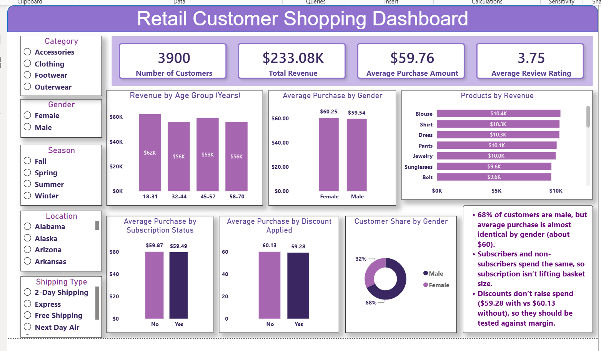

# Retail Customer Shopping Behavior Analysis

End-to-end analysis of 3,900 retail customer transactions using **Python, PostgreSQL, SQL and Power BI**, finding where spend differs across customer groups and where it does not.



## Project snapshot
| | |
|---|---|
| Domain | Retail analytics |
| Data | 3,900 transactions, 18 columns (public customer shopping dataset, [add source link]) |
| Tools | Python (pandas, NumPy, SQLAlchemy), PostgreSQL, SQL, Power BI |
| Deliverables | Cleaned dataset, 10 SQL business queries, one-page Power BI dashboard |

## Business questions
1. Which customer groups (age, gender, subscription status) spend the most?
2. Do subscriptions or discounts change how much customers spend per purchase?
3. Which products and categories drive revenue?
4. How loyal is the customer base?

## Key findings
- **The customer base skews male (68%), but spend per purchase is the same.** Men average $59.54 per purchase and women $60.25. Men's higher total revenue ($158K vs $75K) comes from having more customers, not from spending more.
- **Subscription does not lift spend.** Subscribers (27% of customers) average $59.49 vs $59.87 for non-subscribers.
- **Discounts are not increasing basket size.** 43% of purchases used a discount, and those purchases averaged $59.28 vs $60.13 without. The gap is under $1, so the supported conclusion is that discounts are not raising spend. The business should test whether they are worth the margin they cost.
- **The 18-31 group has the highest revenue ($62K), mainly because it is the largest group** (1,028 customers). Average purchase is about $60 in every age group.
- **Revenue is spread evenly across products.** The top five products (Blouse, Shirt, Dress, Pants, Jewelry) each bring in about $10K, and the 25 products average $9.3K, so no single product dominates. By category, Clothing is the largest at 45% of revenue.
- **The customer base is mostly loyal.** 80% of customers have more than 10 previous purchases, 18% are returning (2-10) and 2% are new.

## Recommendations
- Run a controlled test of discount levels against margin before extending promotions, since discounted purchases are not larger.
- Review the value of the subscription programme, because subscribers are not spending more per purchase.
- Plan acquisition and retention around loyal customers, who make up most of the base.

## Method
**Data preparation (Python)**
- Standardised column names (snake_case).
- Filled 37 missing review ratings (0.9%) with the median rating of the product category.
- Dropped `promo_code_used`, which was identical to `discount_applied` in every row.
- Created `age_group` (quartiles of age, about 25% of customers each: 18-31, 32-44, 45-57, 58-70) and `purchase_frequency_days` (purchase frequency converted to numbers).
- Checked for duplicate rows: none found.

**Storage and analysis (PostgreSQL + SQL)**
- Loaded the cleaned data into PostgreSQL and wrote 10 queries covering revenue by gender and age group, discount behaviour, subscriber comparison, top products per category (window functions), and new/returning/loyal segmentation.

**Dashboard (Power BI)**
- KPI cards: customers, total revenue, average purchase, average review rating.
- Charts: revenue by age group, average purchase by gender, subscription status and discount, customer share by gender, and top products by revenue.
- Slicers for category, gender, season, location and shipping type.

## Limitations
- The dataset has no dates, so trends over time and retention cannot be analysed.
- It has one row per customer, so repeat purchase behaviour is inferred from `previous_purchases` only.
- Most group differences are small (around $1 in average purchase), so findings describe patterns, not proven effects.

## How to run
1. Clone the repository and install: `pip install pandas numpy sqlalchemy psycopg2-binary`.
2. Set your database password as an environment variable: `PG_PASSWORD`.
3. Run `customer_shopping_behavior.ipynb` to clean the data and load it into PostgreSQL.
4. Run `Retail_SQL_Queries.sql` in pgAdmin or any SQL client.
5. Open `Retail_Customer_Shopping_Dashboard.pbix` in Power BI Desktop.

## Repository contents
```
├── README.md
├── customer_shopping_behavior.ipynb     # cleaning, feature engineering, load to PostgreSQL
├── Retail_SQL_Queries.sql              # 10 business queries
├── Retail_Customer_Shopping_Dashboard.pbix
├── customer.csv                        # source data
├── dashboard.png                       # dashboard preview
└── LICENSE
```

## Future improvements
- RFM customer segmentation.
- Predict customer spend with a machine learning model.
- Publish the dashboard through Power BI Service.
- Automate the cleaning and profiling step with a reusable Python script.

## Author
**Anjali Kumari** · [www.linkedin.com/in/anjali-kumari-b5581823a] · [kumarianjali6246@gmail.com]pository.
